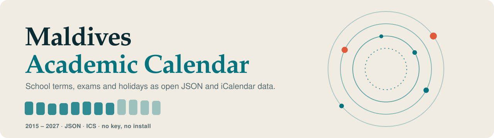
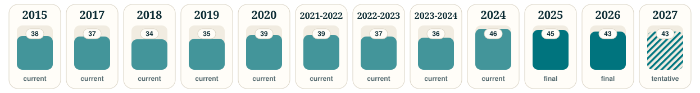
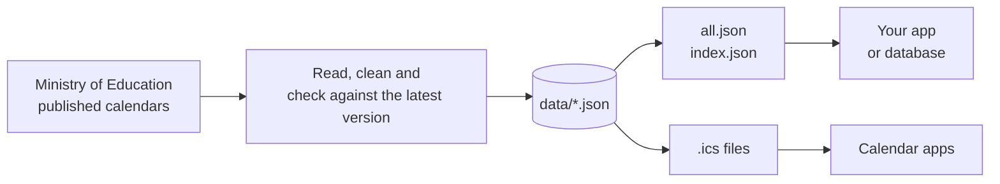

<p align="center">
  <picture>
    <source media="(prefers-color-scheme: dark)" srcset="assets/banner-dark.svg">
    
  </picture>
</p>

<p align="center">
  <a href="https://github.com/grootismore/mv-academic-calendar/actions/workflows/build.yml"></a>
  
  
  
</p>

<p align="center">
  <b><a href="#quick-start">Quick start</a></b> &nbsp;·&nbsp;
  <a href="../../wiki">Wiki</a> &nbsp;·&nbsp;
  <a href="../../discussions">Discussions</a> &nbsp;·&nbsp;
  <a href="../../issues/new?template=data-correction.yml">Report a correction</a>
</p>

> [!IMPORTANT]
> **Unofficial.** This data is compiled from calendars published by the Ministry of Education and is not affiliated with or endorsed by the Ministry.
> Always check the [Ministry's site](https://www.moe.gov.mv/en/academic-calendar) for the authoritative version.

Terms, exams, mid-term breaks, school days and public holidays for the Maldives school year, in two formats everything understands.
Fetch a file and use it. No key, no signup, no install.

## Coverage

<p align="center">
  <picture>
    <source media="(prefers-color-scheme: dark)" srcset="assets/coverage-dark.svg">
    
  </picture>
</p>

<p align="center"><sub>Bar height is the number of entries. <b>Solid</b> = final or current, <b>hatched</b> = tentative and may change. This graphic rebuilds itself whenever the data changes.</sub></p>

## Quick start

Base URL: `https://raw.githubusercontent.com/grootismore/mv-academic-calendar/main/`

```sh
# every event from every calendar, in one request
curl -s https://raw.githubusercontent.com/grootismore/mv-academic-calendar/main/data/all.json

# one calendar
curl -s https://raw.githubusercontent.com/grootismore/mv-academic-calendar/main/data/2026.json
```

<details>
<summary><b>Python</b></summary>

```python
import requests
B = "https://raw.githubusercontent.com/grootismore/mv-academic-calendar/main/"
events = requests.get(B + "data/all.json").json()["events"]
holidays = [e for e in events if e["category"] == "public_holiday" and e["calendar"] == 2026]
```
</details>

<details>
<summary><b>JavaScript</b></summary>

```js
const B = "https://raw.githubusercontent.com/grootismore/mv-academic-calendar/main/";
const { events } = await (await fetch(B + "data/all.json")).json();
```
</details>

<details>
<summary><b>Subscribe in a calendar app</b></summary>

Add `data/2026.ics` as a **URL calendar**. In Apple Calendar: File → New Calendar Subscription. In Google Calendar: Other calendars → From URL.
The file asks apps to refresh once a day.
</details>

## What is in `data/`

| File | What it is |
|---|---|
| [`all.json`](data/all.json) | every event from every calendar in one flat list, each with a stable `id` |
| [`index.json`](data/index.json) | the list of calendars: status, number of entries, file paths |
| `2026.json`, `2023-2024.json`, … | one calendar each, with its source and status |
| `2026.ics`, `2023-2024.ics`, … | the same as iCalendar, one all-day event per entry |
| [`schema.json`](data/schema.json) | JSON Schema for the calendar files |

Academic years that run August to June, as the Ministry has published them since 2021, are named like `2023-2024`.

## How it fits together



The newest published version of each year always wins. Older revisions never replace newer data.

## The format

```json
{
  "id": "6c1f0a8e2b7d94c3a1f5",
  "start": "2026-05-27",
  "end": "2026-05-30",
  "name": "Eid-al-Adha",
  "category": "public_holiday",
  "calendar": 2026,
  "file": "2026",
  "status": "final"
}
```

| Field | Meaning |
|---|---|
| `start`, `end` | ISO dates. `end` is the last day, inclusive. Missing means a single day |
| `category` | `public_holiday`, `school_days`, `exam_days`, `term_holidays` or `other` |
| `status` | `final`, `current` or `tentative` |
| `id` | stable across updates. It only changes if the name or start date changes |

> [!TIP]
> Dates have no time zone. Parse them as local dates (the Maldives is UTC+5), not as UTC, or events will shift by a day.

## Put it in your app

Load `all.json` and **upsert each event by its `id`**. The wiki has a ready table definition, a Node and PostgreSQL example, and notes for mobile apps:
[**Using the data in your app →**](../../wiki/Using-the-Data-in-Your-App)

## Licensing

| What | Licence |
|---|---|
| Code (`build_ics.py`, workflows) | [MIT](LICENSE) |
| The compiled data and graphics (`data/`, `assets/`) | [CC BY 4.0](DATA-LICENSE.md), to the extent the maintainer holds rights in the compilation. Please credit this project and the Ministry as the source |
| The Ministry's own publications | Not licensed here. They remain the Ministry's, and this project does not claim or imply the Ministry's permission |

Details, and what to do if you represent the Ministry: [**DATA-LICENSE.md**](DATA-LICENSE.md). Not legal advice.

## Corrections and community

- **Found a wrong date or name?** [Open a data correction](../../issues/new?template=data-correction.yml) with a link to the source.
- **Questions and ideas:** [Discussions](../../discussions).
- **Guides and the full field reference:** [Wiki](../../wiki).

The data is read from PDFs and then cleaned, so an entry name can still contain a small slip. Dates are the reliable part.
Maintained by the repo owner.
