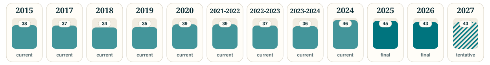
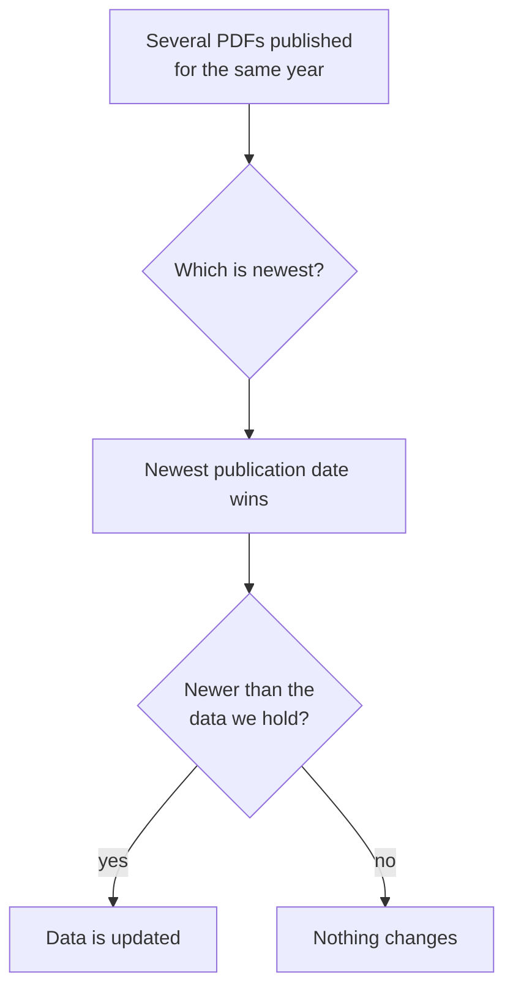

# Calendars and years

  <picture>
    <source media="(prefers-color-scheme: dark)" srcset="https://raw.githubusercontent.com/grootismore/mv-academic-calendar/main/assets/coverage-dark.svg">
    
  </picture>

`data/index.json` is always the up-to-date list. Today it covers 2015 and 2017 to 2027.

## Naming

- **Calendar years** are named `2026`.
- **Academic years** that run from August to June are named `2023-2024`. This is how the Ministry has published them since 2021, so the files `2021-2022`, `2022-2023` and `2023-2024` span two calendar years.

## Status

| Status | Meaning |
|---|---|
| `final` | The Ministry published it as the final calendar |
| `current` | Taken from the Ministry's published calendar, without a final or tentative label |
| `tentative` | A draft that can still change |

## The newest version wins

The Ministry often publishes several versions of a year: a tentative draft, a final, and later revisions. The data always follows the **most recent** one.

## Categories

| Category | Meaning |
|---|---|
| `public_holiday` | Public holidays and the days around them |
| `school_days` | Teaching periods and terms |
| `exam_days` | Examination periods |
| `term_holidays` | Mid-term breaks and term holidays |
| `other` | Everything else: reporting days, professional development days, events |

---
[← Data format](Data-Format) · Next: [Using the data in your app →](Using-the-Data-in-Your-App)
