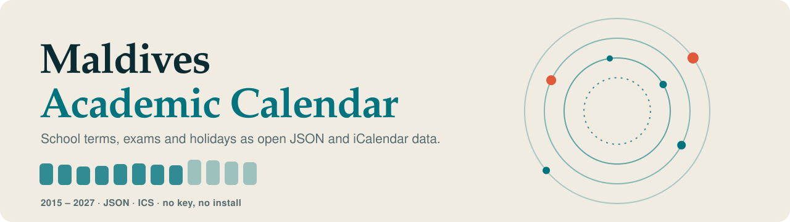
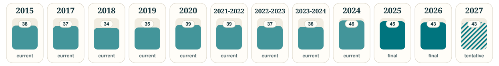

  <picture>
    <source media="(prefers-color-scheme: dark)" srcset="https://raw.githubusercontent.com/grootismore/mv-academic-calendar/main/assets/banner-dark.svg">
    
  </picture>

> [!IMPORTANT]
> **Unofficial.** Compiled from calendars published by the [Ministry of Education](https://www.moe.gov.mv/en/academic-calendar), and kept up to date as newer versions appear. Always check the Ministry for the authoritative version.

Open data for the Maldives school year: terms, exams, holidays and public holidays, as **JSON** and **iCalendar (.ics)**. No key, no install.

## Where to go

| | |
|---|---|
| **[Getting started](Getting-Started)** | Fetch the data in one line, or subscribe in a calendar app |
| **[Data format](Data-Format)** | Every field, with examples |
| **[Calendars and years](Calendars-and-Years)** | Which files exist and what "status" means |
| **[Using the data in your app](Using-the-Data-in-Your-App)** | Load it into a database or an API |
| **[FAQ](FAQ)** | Quick answers |
| **[Where the data comes from](Data-Sources-and-Updates)** | Sources and how updates are handled |
| **[Contributing](Contributing)** | Report a mistake, share what you built |
| **[Licensing](Licensing)** | How the code and data are licensed, and how to give credit |
| **[Changelog](Changelog)** | What changed in each release |

## Coverage

  <picture>
    <source media="(prefers-color-scheme: dark)" srcset="https://raw.githubusercontent.com/grootismore/mv-academic-calendar/main/assets/coverage-dark.svg">
    
  </picture>

Bar height is the number of entries. Solid = final or current, hatched = tentative.

    
   

## Questions and ideas

Use [Discussions](../discussions) for questions and ideas, and [Issues](../issues/new/choose) to report a wrong date or name.
